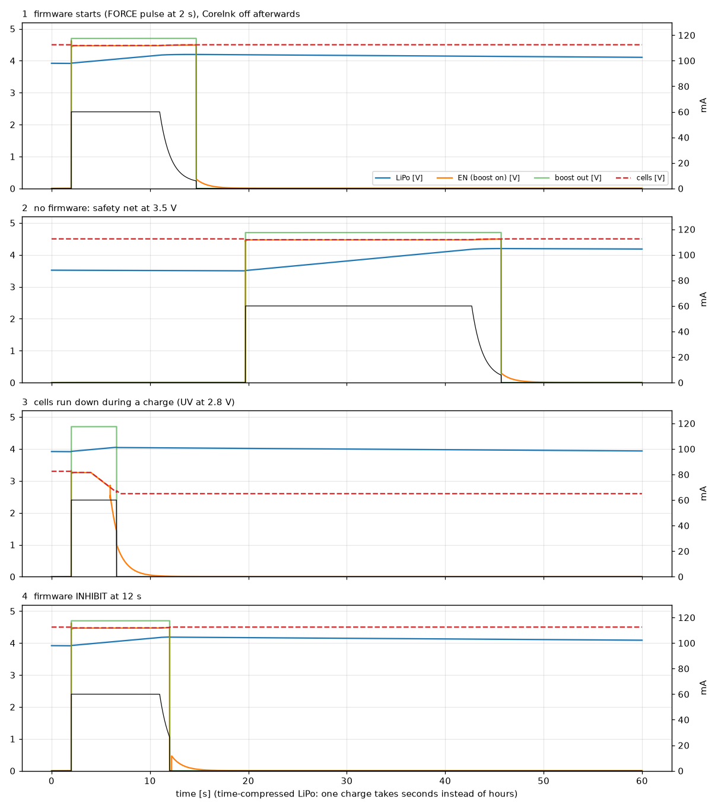

# Simulation results

Generated by `tools/sim/run_sims.py` with ngspice (KiCad 10). Behavioural models (see the script's docstring): they check the logic, levels and currents, not exact waveforms. The LiPo is time-compressed (2 F), so a charge takes seconds.

## 1. Charge control

| Case | Boost starts | Boost stops | Time on [s] | LiPo at the end [V] | On at the end |
|---|---:|---:|---:|---:|:---:|
| 1  firmware starts (FORCE pulse at 2 s), CoreInk off afterwards | 1 | 1 | 12.7 | 4.106 | no |
| 2  no firmware: safety net at 3.5 V | 1 | 1 | 25.99 | 4.182 | no |
| 3  cells run down during a charge (UV at 2.8 V) | 1 | 1 | 4.61 | 3.937 | no |
| 4  firmware INHIBIT at 12 s | 1 | 1 | 10.0 | 4.089 | no |

## 2. Everything off (CoreInk off, not charging), DC

Includes the TPS3840 supply currents (300 nA typ each) and the TPS61023 shutdown current (100 nA, VERIFY); the discrete parts as modelled (no FET leakage).

| Case | From the cells [nA] | From the LiPo [nA] | Into the CoreInk 3V3 rail [nA] | EN [V] |
|---|---:|---:|---:|---:|
| cells full 4.8 V, LiPo 4.1 V | 401 | 300 | -0.0 | 0.01 |
| cells 3.6 V, LiPo 3.9 V | 401 | 300 | -0.0 | 0.01 |
| cells empty 2.7 V, LiPo 3.9 V | 671 | 300 | -0.0 | 0.01 |
