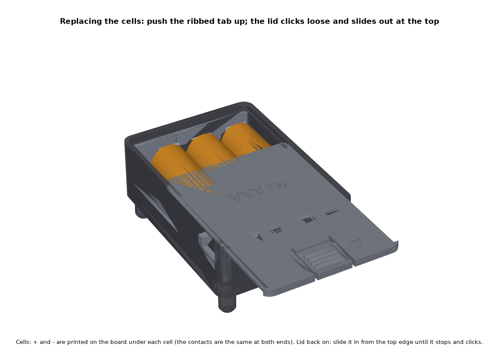

# BatteryBASE enclosure

Generated with CadQuery by [`kuip.py`](kuip.py); the fit check is [`check_fit.py`](check_fit.py), its last result is in
[`fit-check.txt`](fit-check.txt).

```
python enclosure/kuip.py                                   # writes enclosure/fabrication/*.step / *.stl
python enclosure/check_fit.py ../needforheat-p1-base-hardware   # needs a checkout of the P1-BASE repository
python enclosure/callouts.py                                # pictures in docs/images (needs matplotlib, trimesh)
python enclosure/sketch_contacts.py                         # docs/images/sketch-aaa-contacts.png
```

## What it is

The BatteryBASE is always the **last module of a stack** (CoreInk – BatteryBASE, or CoreInk – P1-BASE –
BatteryBASE): its cells must stay reachable. Its PCB is turned "upside down" compared with a first sketch: the
electronics and the bus header are on the PCB's **underside** (towards the CoreInk or the P1-BASE), the cells and
their contacts on the **back side** (towards the lid).

* **Tray** (`battery-base-kuip`): outside exactly the CoreInk outline (40 x 56 mm, R3), walls inside it, like the
  P1-BASE v3; four LEGO-compatible posts underneath (7 mm, three crush ribs) at the CoreInk's LEGO holes; corner
  blocks that carry a 36.3 x 52.3 mm PCB 2.5 mm above the stand-on surface; three pegs at (36, 4), (4, 52),
  (36, 52) that key the PCB, as on the P1-BASE v3. Two corner blocks have a pocket for the solder joint of a contact
  pin. The left long wall is 1.0 mm thin (else 1.6) along the cells, where cell 1 bulges.
* **PCB underside** (electronics): parts up to 2.2 mm tall in the 2.5 mm under the PCB, SMD assembly on this side;
  the contacts' pins are soldered from this side too (JLCPCB Standard PCBA). The bus header is a plain 2x8 male header, pins down, THT (no socket on top: nothing stacks
  behind a BatteryBASE, unlike the P1-BASE's stacking J1).
* **Cell contacts** (back side): six MYOUNG **MY-AAA-01** leaf contacts (C964855, in stock at JLCPCB), the same
  part at both ends, linked in series by PCB tracks. Each has a foot (15.57 x 6.35 mm) under the cell's end,
  raised 0.25 mm off the PCB (its top 0.50 above it) and standing on its inner end and on a 2.33 mm tab behind the
  leaf; two flat 1.0 x 0.25 x 1.5 mm pins in Ø1.2 holes (soldered by JLCPCB from the electronics side); and next to
  the outer pin a leaf 10.1 mm high with a Ø2.5 dimple against the cell's end. The shape is measured from the
  vendor's 3D model (LCSC/EasyEDA, placed by `tools/import_leaf_model.py`). MYOUNG's layout for AAA gives 42.4 mm
  between the outer pads' inner edges, 1.3 mm inside the outer pins: the outer pins are **45.0 mm** apart, the free
  dimples 42.3 mm, and each leaf gives way 0.6–1.3 mm for cells of 43.5–45.0 mm. The **cells lie on the feet** (axis
  5.75 mm above the PCB; dimple centre 6.01). They are packed to the left, away from the bus header, at x = 6.71,
  17.67 and 28.62: the curve of cell 3 clears the header's tails (1.4 mm proud) by 0.56–0.74 mm (vertically) for
  cells of 10.1–10.7 mm. Cell 3's contacts sit 0.75 mm left of its axis (x = 27.87), so that its bottom foot keeps
  0.8 mm from the tails' solder fillets. The tabs reach in under the cradle's end ribs, which have a low notch there. (Until 16 November 2026 the design had MY-AAA-15-J/16-J plates in PCB
  slots; their tab turned out to be bent 90°, which would lay the plate flat.)
  [The sketch](../docs/images/sketch-aaa-contacts.png) shows the compartment as built: top view, a section along a
  cell and section A–A across the cells, through the header.
* **Cradle** (`battery-base-cradle`, a third print): drops in on top of the PCB. End ribs (1.2 mm) behind the
  leaves: a stop for a leaf pushed too far while a cell goes in (the leaves pass the cells' end force through their
  pins into the PCB). Behind each leaf the rib has a 0.4 mm recess from 7.5 mm above the PCB up, for the leaf's
  flared top, which swings back when a long cell presses the leaf; and a low notch over the contact's tab. With the
  vendor's model of the contact, free and pressed by 43.5–45.0 mm cells, every part keeps at least 0.3 mm clear and
  the leaf's top (10.2 mm above the PCB at most) stays 1.5 mm under the lid (`check_leaf.py`); three stops right of cell 3 (y = 14,
  25.5 and 48, clear of the bus header's pins) keep it off the header's tails; one side rail along the right wall.
  Two low bars (1.4 mm wide, 2.0 mm high) between cells 1–2 and 2–3 tie the end ribs together on the left, where a
  rail along the wall does not fit: they run between the contacts' feet and lie in the wedge under two round cells,
  so a cell going in lies flat on its feet beside them. Each cell keeps its own play between the bars (`kuip.py`
  asserts this; [picture](../docs/images/cradle-bars.png)). No saddles or arcs under the cells. **Keyed:** a lip on the top rib (3 mm wide, at x = 30, off centre)
  drops into a vertical groove in the tray's top wall; turned 180° about any axis, the lip lands on the wall and the
  cradle does not go in (`check_fit.py` checks all three). The PCB's keep-outs (both sides), contact and cell
  positions are in [`pcb_constraints.json`](pcb_constraints.json).
* **Plugging in and pulling off** with the whole module: the cradle's end ribs reach to 0.1 mm under the lid, so
  the cradle clamps the PCB between the lid and the tray's corner blocks. Pushing on the tray or the lid: tray ->
  grooves -> lid -> ribs -> PCB -> header pins. Pulling on the tray: corner blocks under the PCB -> PCB -> pins.
  Push it on with the lid in place; pulling it off also works without the lid.
* **Sliding lid** (`battery-base-lid`), like a remote control's battery door. It slides in from the **top edge**
  (HAT side) and stops against the bottom wall, so it stays in when the CoreInk hangs or stands, even if its click
  tab breaks. Its tongue runs in grooves in the long walls and the bottom wall. A flexible tab at the top end
  (thinned, with grip ridges) carries a bump that drops into a dimple in the top of the top wall; both flanks are
  sloped, so a push on the ridges towards the top edge opens it, no pressing needed. The lid's top end is a cap of
  the full CoreInk width that forms the top of the top wall: turned round, the cap leads and cannot enter between
  the long walls (it stops after 1 mm), so the lid fits one way only.
* **Polarity marks** are where the user looks while inserting the cells: a small battery with + and − on the PCB
  silkscreen under each cell, between the contacts' feet (the contacts are the same at both ends). The lid's outside only says "3x AAA", with arrows
  at the tab for the slide direction.
* **Fit model** (`battery-base-fit.step`): tray, lid, cradle, contact placeholders, a PCB placeholder, three AAA cells
  and the 2x8 header.
* **Pictures** (`callouts.py`, adapted from the P1-BASE): `docs/images/enclosure-*-callouts.png` and
  `docs/images/enclosure-lid-sliding.png`.



Height: 17.5 mm above the surface it stands on (the CoreInk's back or the lid of a P1-BASE v3).

**Shipping:** modules ship loose (not stacked) in a PostNL letterbox parcel (max. 38 × 26.5 × 3.2 cm), without
cells. Each module must stay ≤ 27 mm thick from the lid top to the tips of its LEGO posts (≥ 5 mm left for box and
padding); `kuip.py` asserts this. BatteryBASE: 24.5 mm.

**Print orientation:**
* **MJF** (JLC3DP, PA12, the intended process): no orientation to choose. It is a powder bed without supports;
  JLC3DP places the parts to fill the build volume. Bump, tongue and tab print in any orientation.
* **FDM** (PETG): the lid with its **outside down** on the bed. Inside down does not work: the click bump stands
  0.4 mm proud of the underside. Outside down gives a smooth outer face with crisp engraved arrows and text, the bump
  ends up on top, and the tongue's 0.7 mm side step is a short overhang that prints without support. The one place
  that needs support is the thumb recess: the tab (about 10 × 9.5 mm, with its grip ridges) starts 0.7 mm above the
  bed and is fixed at one end only. Support only in that recess (PETG sticks to its own support: use a support
  interface material or a generous Z gap). The layers then run parallel to the tab, so it does not break along a
  layer line when it flexes. The cradle prints as it lies in the tray: its flat underside (ribs, bars, rail and
  stops all stand on the PCB) on the bed. The tray needs support in FDM in any orientation (LEGO posts below,
  pegs and the lid's groove above).

## Assumptions to verify

1. **Contacts** (not parts in hand): the shape comes from the vendor's 3D model, which matches drawing MY-CP-0095;
   how far the leaf may give way (`LEAF_DEFL_MAX` 2.0) and the 45.0 mm pin spacing (the layout's 42.4 read as pad
   edges, as in Keystone's drawing of the same part, 56) need samples. The pins (1.5 mm) end just inside the 1.6 mm PCB:
   JLCPCB's DFM check has to accept that (or a 1.2 mm PCB with MY-AAA-03). Contact pressure with real cells.
2. **Cells**: 10.1–10.7 mm thick and 43.5–45.0 mm long are allowed for (`AAA_D_MIN/MAX`, `AAA_L_MIN/MAX`); each leaf
   gives way 0.6–1.3 mm. Check with a few brands, NiMH included.
3. **Bus header tails** (XKB X6521WV-2x08H-C60D30, 3.0 mm PCB tail): 1.4 mm proud of the back side, under cell 3,
   which clears them by its curve (`HDR_CLR` = 0.3 mm vertically for the thinnest cell against the stop; 0.21 mm
   shortest distance). The stop's position follows from the pins (`X_STOP`).
4. **Thin wall** (1.0 mm, MJF PA12; about 0.8 mm is the usual minimum): check on the print.
5. Sliding fit and click (MJF PA12): 0.2 mm play per side (`SL_CLR`), bump 0.4 mm (`DET_H`), tab 1.3 mm thick and
   about 9.5 mm free (`TAB_T`, `TAB_L`). Estimated: about 4 N on the tab's bump, about 6 N to pull the lid open.
   Adjust after a test print.

## Printed fit check (November 2026)

Five sets of tray + lid (`fabrication/*.stl` as of 15 November 2026) go into the same JLCPCB order as the P1-BASE v3
prototype: JLC3DP, MJF PA12 black, $ 18.70 for five sets. Purpose: check the stack CoreInk – P1-BASE – BatteryBASE
in hand (LEGO posts, snap fit, header reach) before the BatteryBASE PCB is designed. If the PCB later needs other
dimensions, the enclosure is reprinted.

## Fit check (sliding lid)

`check_fit.py`, result in [`fit-check.txt`](fit-check.txt): no collisions inside the BatteryBASE, on a CoreInk or on
a P1-BASE v3 (current `feature/p1-base-v3` checkout). The lid slides out (upwards) over its whole length without touching the
tray, the cradle, the contacts or the cells (the flexing tab left out), and a lid turned round stops 1 mm after entering. The header pins reach
6.0 mm into the bus socket below. Three tolerance cases are checked too: three 10.7 mm cells rolled left and rolled right
as far as the wall, the bars and the stop let them, and a 10.1 mm cell 3 against the cradle stop, over the header's
tails.

## Next: follow the P1-BASE v3 changes of 15 November 2026

Done in the sliding-lid version: points 1 (outline; clip choice still open), 2 (pegs as on the P1-BASE v3), 3 (the
lid fits one way only, by its cap) and 4 (fit check against the current P1-BASE). The original notes: What changed in the P1-BASE repository
(branch `feature/p1-base-v3`, PR #5; see its `enclosure/kuip.py`, `enclosure/README.md` and `TODO.md#batteryflush`):

1. **Outside exactly the CoreInk outline** (40 × 56 mm, R 3), walls inside it, no skirt, so any CoreInk BASE also fits
   behind a module. The P1-BASE PCB became 36.3 × 52.3 mm (`INSET = 1.85` in its `tools/gen_pcb.py`: wall 1.6 +
   clearance 0.25). For the BatteryBASE this is tight along the cells: inside length 56 − 2 × 1.6 = 52.8 mm against
   44.5 mm per AAA cell leaves ≈ 4.1 mm per end for the contacts (now `CLIP_L = 4.5`); across, 3 × 11.2 mm fits the
   36.8 mm inside width. Check real clips or holders that are in stock at JLCPCB before fixing the outline.
2. **PCB pegs** moved to (36, 4), (4, 52), (36, 52) on the P1-BASE (top-left free for its LED); here they are still at
   (4, 4), (36, 4), (4, 52). Either is fine, as long as one corner is free and the PCB fits one way only.
3. **The lid fits one way only.** The P1-BASE lid has an L-shaped corner pillar (`KEY_STRIPS`, 2.5 mm longer along both
   walls) that stops a turned lid on the tray's rim at first touch; snap bumps moved to y = 16 / 40 to make room.
   The BatteryBASE lid has no corner pillars, but it needs a key too, because the polarity marks on it must match the
   cells; a solid feature, not a thin tab.
4. **Stacking:** the P1-BASE lid now has LEGO Technic holes in four corner pillars (counterbore, snap groove at 7.8 mm)
   at the CoreInk's hole positions, and its raised J1 socket (Samtec ESQ-108-24-G-D) flush with the lid. Run
   `check_fit.py` against the current P1-BASE checkout.
5. **Order timing:** the P1-BASE prototype order waits for J1 (pre-ordered, reminder on 8 December 2026). New-user
   coupons expire 14 December 2026. BatteryBASE prints, and a PCBA if ready, can join that shipment.
6. **Tooling to reuse** from the P1-BASE repository: `tools/gen_pcb.py` (placement, Freerouting, stitching that keeps
   vias out of silkscreen text), `tools/pcb_cleanup.py`, `tools/pcb_bridge_gnd.py` (GND islands: via, maze track, or
   rip-up of one net), `tools/export_fab.py` (JLCPCB CPL rotation corrections in `JLC_CORR`), `tools/checks/` and
   `enclosure/callouts.py` (renders with callouts, lid keying picture).
